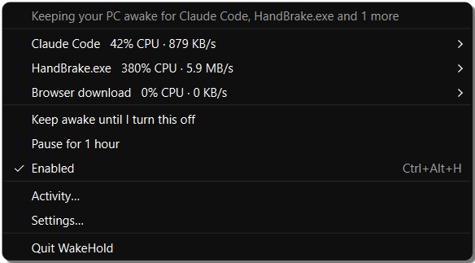
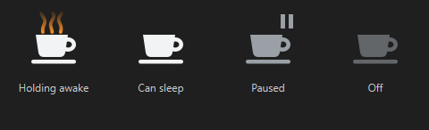
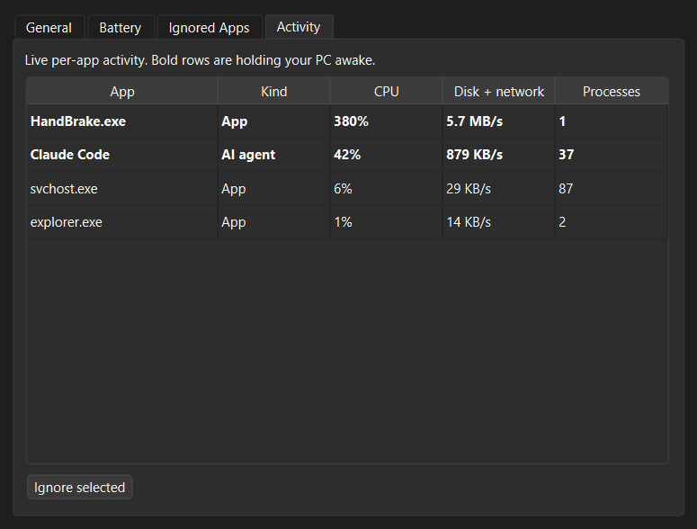
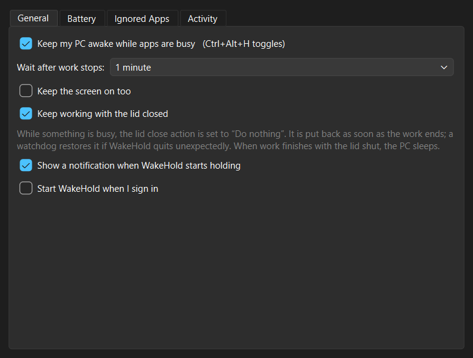
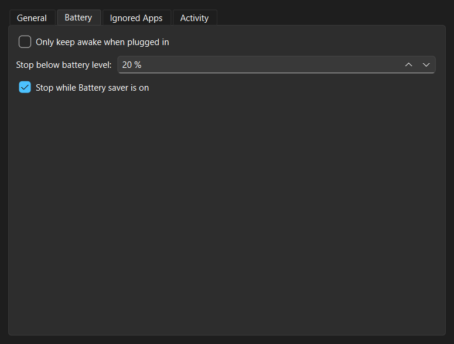
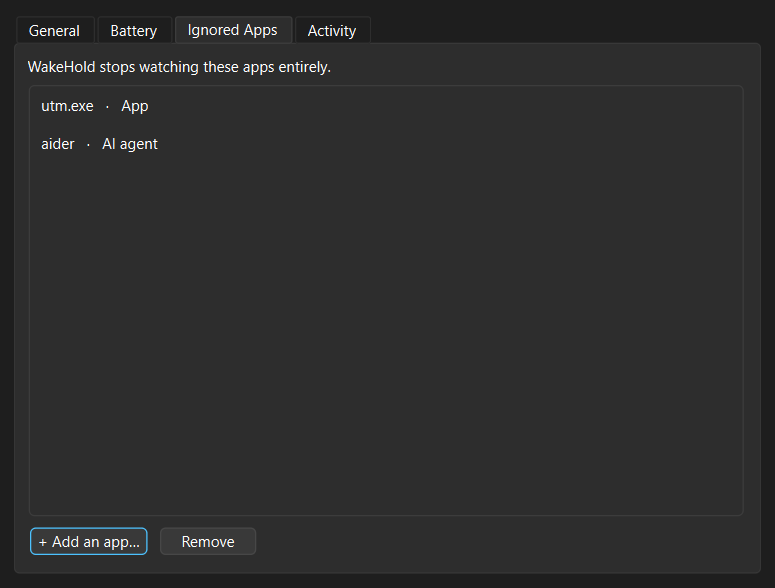

# WakeHold

<p align="center"></p>

A Windows tray app that keeps your PC awake while apps are busy, then lets it sleep.
Inspired by the macOS app [Hold Sleep](https://holdsleep.com); this is an independent
re-implementation built from its public feature description, not from its code.

## Screenshots

These are rendered from the app's real windows and menus with sample data (the
repeatable script is `tools/make_screenshots.py`).

| | |
|---|---|
| <br>**Tray menu** — what is holding your PC awake; hover an app to ignore it | <br>**Tray icon** — steam rises while holding awake |
| <br>**Activity** — live per-app CPU and I/O; bold rows are holding | <br>**General** — wait time, screen, lid-closed mode |
| <br>**Battery guard** | <br>**Ignored apps** |

## What it does

- **Notices** which apps are working: per-app CPU and disk/network I/O, the same counters
  Task Manager shows. Short spikes are ignored; work has to last (4 of the last 6 samples,
  5 s apart).
- **Holds** the PC awake only while something is busy (`SetThreadExecutionState`). The
  screen can still turn off unless you choose otherwise.
- **Lets go** after a wait you choose (30 s to 10 min). If the lid is shut at that point,
  the PC sleeps right away.

### Details

- **AI agents**: Claude Code, Codex, Gemini CLI, Aider, OpenCode, Cursor Agent, Copilot CLI
  and Goose are recognised by exe name or command line. Every process they start (builds,
  tests, `npm`, `cargo`…) counts as the agent working, and agents get a 2-minute grace for
  thinking pauses. The Claude *desktop* app is not mistaken for Claude Code.
- **Browser downloads** are detected from growing `.crdownload` / `.part` files in your
  Downloads folder. A browser's own counters never count, because browsers use CPU and
  write to their cache all the time just playing video.
- **Music and calls aren't work**: Spotify, VLC, Media Player, Zoom, Teams, Slack, Discord
  and Windows' own background services are never counted.
- **Lid-closed mode** (opt-in): while work runs, the power plan's lid-close action is set
  to "Do nothing", and the original value goes back as soon as work ends. The original is
  saved to disk *before* the change. A watchdog process restores it within ~2 s if WakeHold
  is killed, and the next launch restores it if both died. No admin rights are needed.
- **Battery guard**: only when plugged in, stop below a battery level, and stop in
  Battery saver.
- **Control**: pause for 1 hour, "keep awake until I turn this off", and toggle on/off from
  anywhere with **Ctrl+Alt+H**.
- **Ignore list**: hover a busy app in the tray menu and choose *Ignore*, or manage the list
  in Settings › Ignored Apps. The live Activity tab shows exactly what each app is doing.
- **Privacy**: everything is local. No network requests, no account, no telemetry.

## Run

```bash
pip install -r requirements.txt
pythonw app.py
```

## Build

```bash
powershell -ExecutionPolicy Bypass -File build.ps1
```

This runs the tests, then produces `dist\WakeHold\WakeHold.exe`.

## Files

Settings, logs and the lid-state marker live in `%APPDATA%\WakeHold\`.

## Known limits

- Windows doesn't expose per-process network bytes without ETW/admin, so "I/O" is
  read + write + other bytes from `GetProcessIoCounters`. Socket traffic shows up in
  *other*, but not exactly.
- Apps' own "don't sleep" requests (`powercfg /requests`) need admin to read, so they are
  not used. Only measured activity counts, which also means apps that ask to stay awake
  forever can't fool it.
- Lid-closed mode changes the *active* power plan. If you switch plans while work is
  running, the original plan's value is the one restored.
